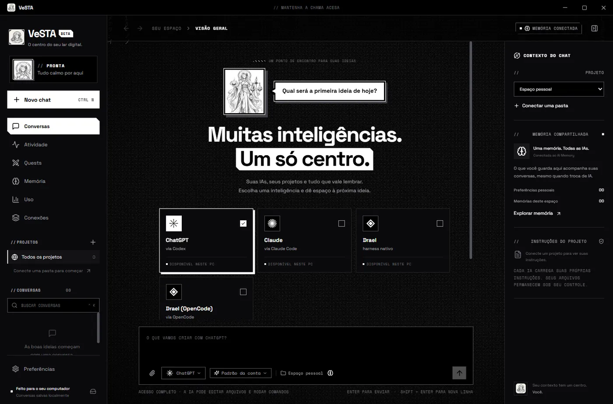
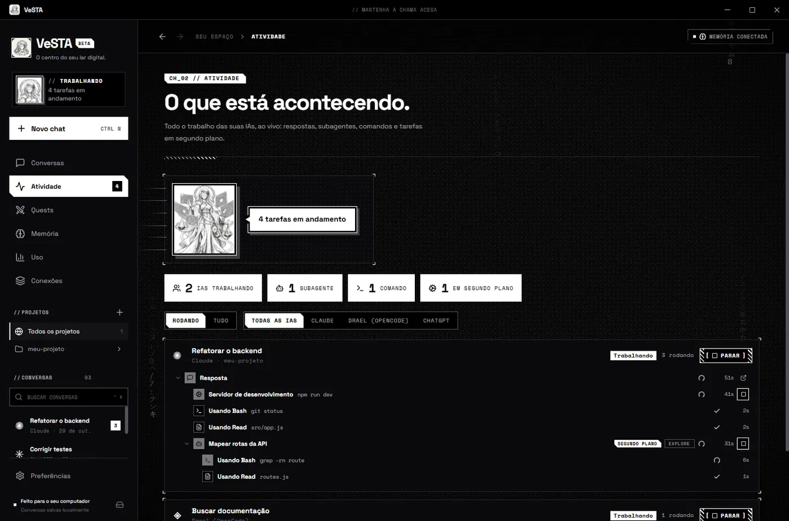
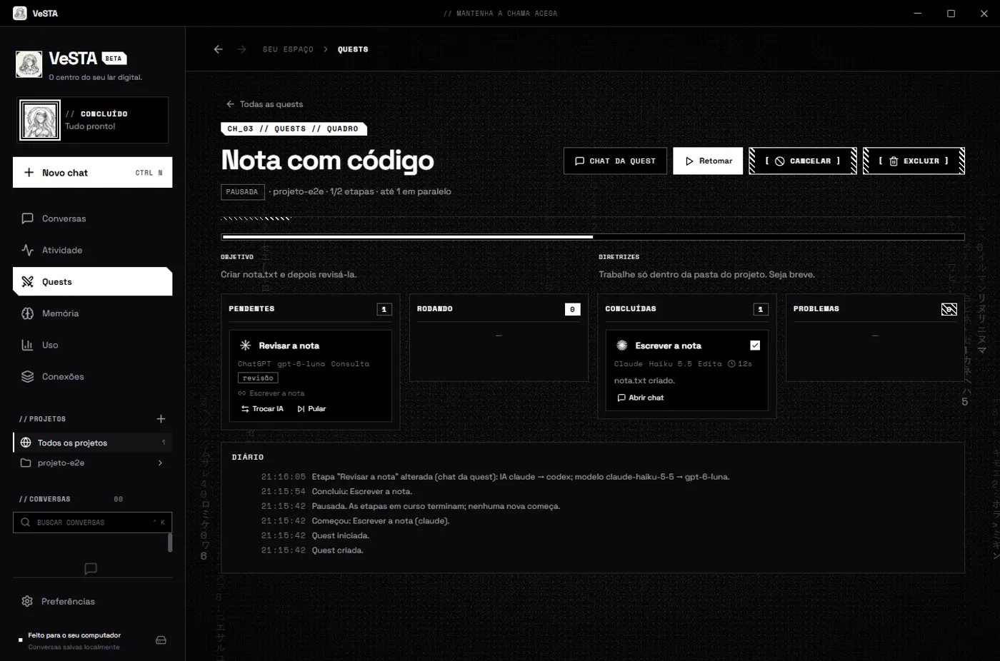

<p align="center">
  
</p>

<h1 align="center">VeSTA</h1>

<p align="center">
  <strong>O centro do seu lar digital: todas as suas IAs num lugar só, com uma memória que aprende como você trabalha.</strong>
</p>



## Por que o VeSTA

Cada IA esquece tudo quando a conversa acaba. Você repete, toda vez, como gosta de trabalhar. E o trabalho fica espalhado: um chat aqui, um terminal ali, outra IA em outro canto.

O VeSTA junta tudo. Suas IAs ficam lado a lado, e uma **memória compartilhada** aprende suas preferências e passa o que sabe de uma IA para outra. Tudo roda no seu computador, com as suas contas.

O nome vem de Vesta, a deusa romana do lar e do fogo no centro da casa. O **e** minúsculo é a chama digital.

## Instalar

1. Tenha pelo menos uma destas IAs instalada e com login feito: **Claude Code** (Claude), **Codex** (ChatGPT) ou **OpenCode** / **Drael**.
2. Baixe o `VeSTA-Setup-<versão>.exe` na [última Release](https://github.com/ThiagoSouzaF/VeSTA/releases/latest).
3. Execute. O atalho **VeSTA** aparece no menu Iniciar.

Pronto. O app avisa quando sai versão nova e se atualiza sozinho (com a sua permissão). Por enquanto, só Windows 64 bits.

## Primeiros passos

1. **Conecte um projeto.** No **Início**, clique em **Conectar uma pasta** (ou use o espaço pessoal).
2. **Escolha o projeto** clicando no quadrado dele, ou **abra um novo chat** (**Ctrl+N**). Escolha a IA, o modelo e o modo de trabalho.
3. **Escreva.** A IA usa a conta que você já tem logada.
4. **Anexe o que precisar:** imagens e documentos pelo clipe, arrastando ou colando com Ctrl+V.
5. **Ensine a memória.** Em **Memória**, escreva suas preferências (idioma, organização de arquivos...) ou notas de um projeto. Com **Aprender com as conversas** ligado, ela também aprende sozinha.

Atalhos: **Ctrl+K** busca conversas, **Ctrl+B** abre e fecha a lista de conversas, **Enter** envia, **Shift+Enter** pula linha, **Ctrl +/−/0** muda o tamanho do texto.

## O que ele faz

- **Início com seus projetos.** O app abre numa tela limpa com cada projeto num quadrado: quantas conversas tem, quando foi usado e o que está rodando nele. Um clique abre a conversa mais recente do projeto. Há também um campo para uma pergunta rápida, sem projeto.
- **Mais espaço para o chat.** À esquerda fica só um trilho de ícones. As conversas abrem numa gaveta ao lado (ícone de conversas ou **Ctrl+B**), e o contexto do chat (projeto, memória e instruções) aparece só quando você clica em **Contexto**.
- **Processos paralelos sempre à vista.** Subagentes e comandos em segundo plano ficam numa faixa fixa logo acima da caixa de mensagem, com o tempo de cada um. Aberta, ela separa o que está rodando, o que terminou e o que falhou, mostra o passo atual de cada subagente e tem "ver no chat" e parar.
- **Conversas organizadas por projeto.** Na gaveta de conversas, cada projeto é uma pasta que abre e fecha, com as suas conversas e o "+" para começar outra ali. Dá para recolher tudo de uma vez e arrastar uma conversa para outro projeto: ela leva o histórico e a memória junto, e a próxima resposta já trabalha na pasta nova.
- **Várias IAs, uma conversa.** ChatGPT (Codex), Claude e Drael. Troque de IA ou de modelo no meio do chat e o histórico vai junto. No menu do modelo, escolha também o **esforço** da conversa no Claude e no Codex: baixo para respostas rápidas, alto ou máximo quando a tarefa pede mais raciocínio.
- **Memória compartilhada (AI Memory).** Guarda suas preferências e o contexto de cada projeto, aprende com as conversas e passa tudo entre as IAs. Funciona offline.
- **Skills.** Receitas de trabalho (revisar um PR, escrever commits, depurar) que você ensina uma vez e todas as IAs seguem, como a memória. Traga de um link do GitHub, de um arquivo, do texto colado ou das skills que o Claude e o Codex já têm; uma IA à sua escolha adapta cada uma para funcionar nas quatro, e você revisa lado a lado antes de salvar. Chame no chat com **/nome**, em qualquer parte do pedido e quantas quiser (até 5), ou deixe a IA usar quando o pedido combinar. Para entender uma skill sem ler o texto todo, use **/explain-skill nome [ia]**.
- **Refinar skills e agents.** Na gaveta de uma skill ou de um agent, **Refinar com IA** abre um chat em que a IA escolhida lê o texto em uso, como ele foi usado (o pedido, a resposta e o que você disse depois; num agent, as execuções, as falhas e as lições) e o que a memória já sabe. Com o método do skill-creator, ela diagnostica, conversa e propõe uma versão nova. A proposta espera o seu sim, com as diferenças linha a linha, e toda mudança guarda a versão anterior, que pode voltar. O **refino automático** (desligado de fábrica) conta, sem IA, os usos corrigidos, os erros e as lições esperando, e manda os mais urgentes para uma IA que revisa no horário escolhido e deixa propostas. **Testar** roda pedidos de teste com a versão atual e com a proposta, e um juiz às cegas compara as respostas e confere se a descrição faz a IA escolher a skill.
- **Diagramas e ilustrações no chat.** Quando a IA responde com um bloco `mermaid`, o chat desenha o diagrama; com um bloco `svg`, mostra a ilustração. As duas passam por um filtro que tira tudo o que roda ou carrega de fora.
- **Atividade.** Veja ao vivo tudo o que as IAs estão fazendo em paralelo: respostas, subagentes, comandos e tarefas em segundo plano. Dá para parar qualquer uma.
- **Quests.** Dê um objetivo e várias IAs trabalham juntas: uma planeja, cada etapa vai para a IA escolhida e os resultados passam de uma para a outra. O **chat da quest** conhece tudo o que está acontecendo e reorganiza o plano conforme você conversa.
- **Agent Mode.** Agents com nome que trabalham sozinhos: você escolhe a IA, escreve o pedido e diz quando roda (todo dia, dias úteis, dias da semana, a cada X horas ou só quando pedir). Cada um usa a memória e as skills do VeSTA (e skills próprias, que vão inteiras em toda execução), aprende com os erros e com as suas correções (cada lição vale só depois do seu sim), guarda um diário com o resumo de cada execução e aparece numa visão geral com o dia de hoje em linhas do tempo, quem está ativo, rodando, esperando você ou com falha.
- **Processos longos acompanhados.** Pediu algo demorado (um build, um servidor, uma tarefa em segundo plano)? A IA volta sozinha quando termina.
- **Anexos.** Imagens e documentos (PDF, texto, Word, Excel, PowerPoint e código) nos chats, no desktop e no celular.
- **Backup em .zip e no Google Drive.** Suas conversas, memórias e preferências num .zip compacto, legíveis em Markdown fora do VeSTA, feito todo dia em segundo plano e enviado direto ao seu Google Drive (com a sua própria chave do Google Cloud, que a tela de Backup ensina a criar). Se a rede cair no meio, o envio continua de onde parou e o download só substitui o arquivo quando chega inteiro. Em outro computador, conecte a mesma conta e restaure de lá.
- **Peça ao próprio VeSTA, numa conversa.** "Mude o tema para Papel", "faça um backup agora", "monte uma quest para lançar o site e já inicie": a IA ajusta as preferências e cria, inicia e acompanha quests no projeto da conversa. Login no Google, restauração e controle pelo celular continuam só na tela Preferências.
- **Uso e limites.** Veja quanto resta do plano do Claude e do Codex, e quantos tokens cada IA gastou por dia.
- **Controle pelo celular.** Acompanhe e responda pedidos de permissão do sofá, por uma rede privada (Tailscale). Vem desligado.
- **Visual Tinta Mangá e a Vesta.** Preto e branco, traço de mangá, chuva de código em tinta. A mascote muda de pose conforme as IAs trabalham, pensam, acertam ou erram (e pode ser escondida).
- **Você escolhe o quanto a IA pode fazer** (por conversa):
  - **Consulta:** só lê e conversa. Não altera nada.
  - **Pedir permissão:** a IA trabalha, mas cada comando ou alteração de arquivo passa por você, na própria conversa.
  - **Acesso completo:** a IA edita arquivos e roda comandos **sem perguntar**. Use só em projetos em que você confia.





## Privacidade e segurança

- **Tudo local.** Conversas, memória e anexos ficam no seu computador, em `%APPDATA%/VeSTA`. Sem conta no VeSTA, sem nuvem própria.
- **Backup é seu.** O .zip vai para a pasta que você escolher (por padrão `Documentos\VeSTA-backups`) e, se você conectar, para o seu Google Drive, onde o VeSTA só enxerga os arquivos que ele mesmo criou (escopo `drive.file`). Com **Proteger com senha**, o backup inteiro sai criptografado (AES-256-GCM, chave derivada da senha com scrypt) e nem o Drive nem quem tiver acesso à pasta consegue lê-lo. A senha e a chave do Google ficam seladas pelo cofre do Windows (DPAPI), nunca em texto puro e nunca dentro do backup; o pareamento do celular também fica de fora.
- **Sem telemetria.** O VeSTA não coleta nada. Os programas que ele abre (Claude Code, Codex, OpenCode) recebem as opções que desligam telemetria, relatórios de erro e envio automático de sessões (o AI Memory não tem telemetria), e o Chromium do app não faz downloads em segundo plano (corretor ortográfico, atualização de componentes, tradução). A única consulta automática é a busca por versão nova no GitHub ao abrir, que pode ser desligada em Preferências → Atualizações.
- **Memória offline.** O motor de memória busca por texto, sem API e sem baixar modelos.
- **Cada IA recebe só o que você manda a ela.** As mensagens e o contexto recuperado vão para o provedor escolhido, com a sua assinatura ou chave, e valem os limites e a cobrança dessa conta. A consolidação da memória manda trechos das conversas (de qualquer IA) para a IA que você escolher em **Memória → Consolidar**, só a ela.
- **Nada global é alterado.** O VeSTA não mexe nas configurações dos seus programas de IA (`~/.claude`, `~/.codex`, OpenCode).
- **Controle remoto desligado por padrão.** Quando ligado, só aceita aparelhos da sua rede Tailscale, pareados com código de uso único e **autorizados por você no desktop**. Dar Acesso completo pelo celular também pede sua confirmação no desktop.

---

# Para desenvolvedores

Requer Node.js 22+ e Windows x64.

## Estrutura e comandos

```text
electron/
  main.cjs        abertura (splash, janela, serviços), IPC e saída
  app/            janela, serviços, preferências, privacidade, cofre de segredos, atualização, store
  ai/             cada IA: localizar, montar o comando (providers/), rodar (drivers/), ler a saída (providers/parser/)
  chat/           enviar uma mensagem, contexto do turno, acompanhamento, troca de IA
  memory/         cliente do AI Memory, sessões, servidor (lock/spool), métodos da tela Memória
  quests/         motor, ferramentas e servidor MCP do chat da quest
  agents/         Agent Mode: relógio, execuções (cada uma é um chat) e métodos da tela
  refine/         refinar skills e agents: o contexto do chat de refino, a proposta, aplicar e voltar versões, o chat oculto (ask), a revisão automática (auto) e o teste A/B da proposta (trial)
  mcp/            base dos servidores MCP do VeSTA, o vesta-app (preferências pelos chats) e o vesta-skills
  skills/         biblioteca de skills: formato, importação (texto, arquivo, GitHub, IAs instaladas) e adaptação
  backup/         .zip, criptografia, restauração e Google Drive
  attachments/    anexos: regras, armazenamento e o protocolo vesta-attachment://
  remote/         controle pelo celular
  shared/         módulos puros usados também pela interface (tarefas, quests, agents, diff e versões do refino)
  util/           texto, processos, portas e escrita segura de arquivos
src/              interface (React); settings/ tem uma seção por arquivo
mobile/           app do celular (PWA)
```

```text
npm ci
powershell -File scripts/download-memory.ps1
node scripts/icon.cjs
npm run build
npm start
npm test
node scripts/test-memory.cjs
node scripts/test-providers.cjs
npx electron scripts/test-permissions.cjs claude allow
npx electron scripts/test-claude-background.cjs
npx electron scripts/test-claude-stale-task.cjs
npx electron scripts/test-memory-agent.cjs claude
node scripts/test-remote-e2e.cjs
node scripts/test-attachments-e2e.cjs [claude] [codex] [opencode] [drael]
node scripts/test-splash-e2e.cjs
npm run dist
npm run installer
npm run release
```

Desenvolvimento do app móvel: `npm run dev:mobile` (Vite) e `npm run build` (gera `dist/` e `dist-mobile/`, ambos empacotados). O design do tema está em [`docs/DESIGN.md`](docs/DESIGN.md).

## Testes

- Os testes de integração usam pastas temporárias próprias, independentes da localização do checkout. **Os testes E2E abrem janelas do app fora da tela.** Ao terminar, cada E2E apaga a sua pasta temporária (mantida quando falha, para inspeção) e as sessões que o Claude Code gravou para ela em `~/.claude/projects`; `VESTA_KEEP_SCRATCH=1` guarda tudo.
- `npm test`: unidades, inclusive servidor HTTP/WS real em localhost, Codex e OpenCode falsos que travam ou caem no meio do turno, o Google falso respondendo 503 e cortando o envio, e a tabela de quando o celular precisa de um sim no desktop para dar acesso completo.
- `test-providers.cjs`: duas chamadas curtas em cada conta configurada.
- `test-permissions.cjs` (`claude`, `codex` ou `opencode`, mais `allow`, `deny`, `subagent`, `always` ou `stop`): a IA real pede permissão para um `mkdir` e o teste confere o efeito de cada resposta.
- `test-ui-smoke.cjs` (com `node`): percorre as telas com dados de exemplo. Inclui o Início (quadrados com o que roda em cada projeto), a faixa de processos entre a conversa e a caixa de mensagem (abas, passo atual, "ver no chat", parar), a gaveta de conversas (trilho e Ctrl+B) e o contexto em popover.
- `test-tree-e2e.cjs` (com `node`): conversas por projeto na gaveta, recolher tudo, "+" do projeto, arrastar uma conversa (a próxima resposta roda na pasta nova com o histórico) e o esforço escolhido no menu do modelo chegando à IA.
- `test-skills-e2e.cjs` (com `node`, sem IA real): a tela Skills com a `/ui-revamp` e a `/explain-skill` que vêm com o VeSTA (removidas, não voltam), colar uma skill e adaptar (revisão lado a lado), a gaveta ("Só com /" sai da lista e o custo acompanha), trazer uma skill do Codex de uma pasta falsa (com a verificação apontando o `npx` sem versão), o menu **/** no chat (Tab completa, o selo na mensagem, o texto da skill e a lista chegando à IA), duas skills chamadas no meio do pedido (o menu no cursor, Enter completa, uma etiqueta para cada, o pedido antes das skills) e capturas nos temas Tinta Mangá e Papel.
- `npm test` inclui `skills.test.cjs`: formato do SKILL.md, biblioteca em disco, leitura das skills do Claude e do Codex, links do GitHub contra uma rede falsa, a resposta da adaptação, o /nome (no começo, no meio, várias, e o que não conta, como `src/nome`), o servidor vesta-skills com token por chat (ferramentas marcadas como só leitura) e a busca de uma skill pelo nome na biblioteca e nas IAs. `skills-health.test.cjs`: a verificação na importação (cada risco e aviso, segredo nunca exibido, a lista no pedido de adaptação). `skills-bundled.test.cjs`: as skills que vêm com o VeSTA entram uma vez, removidas não voltam, uma versão nova só substitui a cópia não editada, e a `ui-revamp` e a `explain-skill` estão bem formadas.
- `test-agents-e2e.cjs` (com `node`, sem IA real): a tela Agent Mode (números, linhas do dia, cartões, filtros), criar um agent pelo formulário (IA, projeto, dias úteis numa hora, modo), "Rodar agora" (rodando, o resumo no cartão e no diário, o pedido que chega à IA, a conversa fora de Conversas), uma skill própria chegando inteira, o relógio rodando um agent na hora marcada, o selo no trilho, o aprendizado (lições e pedido sugerido esperando o sim, manter, apagar, ensinar, e o que foi mantido chegando à execução seguinte com as falhas recentes), desligar e ligar, e capturas nos temas Tinta Mangá e Papel. `npm test` inclui `agents.test.cjs`: a agenda (próxima hora, texto), o formulário, o resumo, as execuções, o relógio, o que acontece ao reabrir (execução interrompida, hora perdida), as lições e o pedido sugerido (só valem com o sim, apagadas não voltam), as falhas recentes e as skills próprias no pedido.
- `test-refine-e2e.cjs` (com `node`, Claude real): numa pasta descartável, refina a skill `/commit-curto` (usada uma vez e corrigida depois) e um agent com uma lição e uma falha, pelas telas: escolher a IA e o modelo, o chat de refino com o contexto escondido, a proposta na barra com as diferenças, **Aplicar**, a versão anterior em **Versões** e **Voltar a esta**. `npm test` inclui `refine.test.cjs`: o diff, as versões (numeradas, até 15, guardadas ao editar e ao atualizar), a evidência e o contexto do refino, a checagem da proposta (nome mantido, descrição obrigatória, risco recusado), aplicar e voltar em skills e agents, e as ferramentas de refino só no chat de refino. Antes do fluxo manual, o E2E confere os sinais (1 uso, 1 correção), roda **Revisar agora** (Claude haiku, 1 por vez) até a proposta da revisão automática e usa **Testar** até o veredito do juiz e a checagem da descrição. `refine-auto.test.cjs` cobre os sinais e a ordem dos candidatos, a leitura de JSON das respostas, o chat oculto, a revisão automática e o teste da proposta (com IA falsa).
- `test-explain-skill-e2e.cjs` (com `node`, Claude real): `/explain-skill commit-curto claude` acha uma skill na pasta `.claude/skills` de um projeto descartável pela `vesta_skill_find` em Só consulta, a resposta traz diagrama, ilustração e Detalhes, e o chat desenha o diagrama (com rótulos) e a ilustração, sem nada que rode ou carregue de fora. `frontend-logic.test.cjs` cobre os blocos `svg` e `mermaid` do markdown.
- `test-memory-consolidation-e2e.cjs` (com `node`, Claude real): uma conversa num projeto fecha por inatividade e fica esperando, o painel **Consolidar** da tela Memória mostra "1 conversa esperando", a agenda (a cada 6 horas) é salva na hora, **Consolidar agora** roda o Claude numa conversa oculta, a regra extraída aparece na tela e na busca do AI Memory, duas memórias repetidas viram uma só e a nota que você escreveu fica intacta. `npm test` inclui `memory-consolidator.test.cjs`: o pedido por projeto (sem segredos), a leitura da resposta (pastas certas, caminho desconhecido nunca aceito, página existente atualizada), juntar memórias repetidas (só as que vieram de conversas, nunca as suas), a recusa de uma resposta que apagaria quase tudo, a agenda revisando só o que mudou, a fila, as falhas (até 3 tentativas), a conversa apagada, a validação da IA e da agenda e o relógio (hora perdida, nada esperando).
- `test-effort-e2e.cjs` (com `npx electron`, Claude e Codex reais): cada IA responde com esforço baixo e máximo.
- `test-chat-quest-e2e.cjs` (com `npx electron`, Claude real): um chat cria e inicia uma quest pelo VeSTA e ela roda até o fim no projeto.
- `test-drive-e2e.cjs` (com `npx electron`; `ai` inclui chats reais): Google Drive contra um Google falso local (login, envio, lista, restauração) e preferências mudadas por chats do Claude e do Codex.
- `test-backup-e2e.cjs` (com `npx electron`; `from=<pasta>` mede com uma cópia de outros dados): backup com o AI Memory real e restauração numa pasta vazia, conferindo que a memória restaurada responde.
- `test-memory-agent.cjs` (`claude`, `codex` ou `opencode`): o agente real consulta e grava no AI Memory por MCP numa pasta temporária.
- `test-remote-e2e.cjs`: abre o app, pareia e usa o app móvel com Playwright em 390x844. Envia uma mensagem real ao Claude haiku, a menos que `VESTA_E2E_NO_AI=1`; screenshots em `VESTA_SHOTS`. Nunca roda `tailscale serve` e só usa `127.0.0.1`. Responde sozinho aos diálogos de confirmação com `VESTA_TEST_AUTO_CONFIRM=1` (`deny` recusa); a variável é ignorada pelo app empacotado.

## Atualizações e releases

A versão instalada procura, ao abrir, a última Release de [ThiagoSouzaF/VeSTA](https://github.com/ThiagoSouzaF/VeSTA/releases) usando o login do GitHub CLI (`gh`) da máquina, já que o repositório é privado. Se a versão for maior, pergunta antes de atualizar; com **Atualizar agora**, baixa o instalador, confere o SHA-512 registrado no `latest.yml`, fecha o VeSTA, instala em modo silencioso e abre de novo. Também há o botão **Procurar atualizações** nas preferências. A versão portátil e a execução em desenvolvimento não se atualizam sozinhas.

Para publicar: aumente `version` no `package.json`, faça commit e push, e rode `npm run release`. O script exige árvore limpa e o commit já no GitHub, gera o instalador e cria a Release `v<versão>`. O instalador é publicado como `VeSTA-Setup-<versão>.exe`, e o `appId` é `app.vesta.desktop`.

`runtime/ai-memory.exe` veio da versão oficial v3.0.0, com SHA-256 verificado. Para reconstruir em outro checkout, consulte `scripts/download-memory.ps1`. Dependências, executáveis gerados, runtime baixado, credenciais, chats e memórias não entram no Git.

## Funcionalidades em detalhe

- ChatGPT pelo Codex CLI, Claude pelo Claude Code e Drael pelo harness oficial ou pelo OpenCode configurado no computador.
- Vários chats independentes, inclusive simultâneos, com retomada da sessão nativa e histórico local.
- Projetos vinculados a pastas, executados com o diretório de trabalho correto.
- Uso dos arquivos de instruções nativos: AGENTS.md, CLAUDE.md e configuração do OpenCode. O aplicativo não os substitui nem os reescreve.
- Tema **Tinta Mangá** (padrão): preto e branco puros, cantos retos, sombras duras, hachura no lugar do vermelho, fontes Space Grotesk e Space Mono embutidas (funciona offline) e chuva de código em tinta, estilo filme antigo. **Papel** é o mesmo desenho em tinta escura sobre papel creme, também sem cor. Seguem disponíveis Obsidiana e Aurora, com quatro cores de destaque (incluindo **Brasa**); escolhas persistentes.
- **Movimento** com uma escala só (`src/styles/motion.css`, tokens do [transitions.dev](https://transitions.dev)): títulos que sobem ao abrir a tela, diálogos que crescem e saem encolhendo, menus que nascem do botão, gavetas que deslizam, toast que sobe, abas com tinta que desliza, ícone de copiar que vira check e badge que salta. Hover e clique seguem as regras de tela de app do [TasteSkill](https://www.tasteskill.dev) (botão sobe 1px e afunda ao clicar, quadrado levanta 2px, texto de leitura de 11px para cima, nada se move ao rolar). No Tinta e no Papel as cores mudam de uma vez, como impressão; só a forma desliza. Com "reduzir movimento" no sistema, tudo aparece parado.
- Peças do [React Bits](https://reactbits.dev) em `src/components/bits/` (código copiado, sem dependência nova, licença em `LICENSE-react-bits.md`): a grade que mostra a IA trabalhando com o tempo decorrido (LatticeLoader), faíscas de tinta ao enviar (ClickSpark), o capítulo que se decifra ao abrir a tela (DecryptedText) e os percentuais do Uso que contam até o valor (CountUp).
- Tela de abertura (splash) com a Vesta e uma barra que acompanha as etapas reais do início: dados, memória, IAs e interface.
- Markdown, atividades das ferramentas, cancelamento, renomeação, exclusão e exportação de conversas.
- Botão no canto inferior direito para retomar o chat no terminal nativo, no mesmo modo do chat.
- **Atividade**: todo o trabalho em paralelo de todas as IAs, ao vivo e em árvore (turno → subagentes → comandos, ferramentas, tarefas em segundo plano e Monitor), com tempos, detalhes, filtros e Parar (por chat; por tarefa no Claude). A gaveta de conversas mostra quantas tarefas rodam em cada chat, e cada chat tem a faixa de processos acima da caixa de mensagem.
- **Quests**: uma IA planeja (ou você monta o plano), cada etapa vai para a IA escolhida num chat próprio, os resultados passam de uma etapa para a seguinte e ficam no AI Memory, e o quadro mostra Pendentes, Rodando, Concluídas e Problemas. Cada quest tem um **chat da quest**: ele recebe a ideia (o planejamento acontece nele) e, a cada mensagem sua, vê a situação, os resultados e um trecho da conversa de cada etapa, com atalhos para abrir os chats das etapas e voltar ao quadro. Os chats criados por quests ficam fora de Conversas.
- **Uso por IA**: janelas oficiais do plano do Claude (5 h e semanal) e do Codex (lidas do `codex app-server`), além de tokens e custo por dia de cada IA.
- **Leitura confortável**: zoom do texto de 80% a 160% (**Ctrl +**, **Ctrl −**, **Ctrl 0** ou Ctrl+roda); a conversa só rola sozinha se você estiver no fim, com botão para descer até o fim. **End** vai ao fim da conversa.
- A mascote é a própria Vesta, em mangá preto e branco: guardiã da chama, com a balança de Libra (o equilíbrio entre as IAs), o jarro de Aquário (o fluxo de dados) e vendada como a justiça. Ela muda de pose conforme o que as IAs estão fazendo (parada, pensando, trabalhando, sucesso, erro, dormindo) e pode ser escondida nas preferências; a página **Conheça a VeSTA** conta a história.
- Fundo da área principal nas preferências: **Liso**, **Brasa** (fagulhas subindo), **Chuva de código** (caracteres caindo, bem de leve; no tema Tinta Mangá vira uma chuva monocromática de filme antigo, com granulação, vinheta e cintilação), **Chuva em tinta** (essa mesma chuva, em qualquer tema) ou **Fluxo de texto** (palavras atravessando a tela), sempre nas cores do tema e mais calmos no centro, onde se lê a conversa. Com "reduzir movimento" ligado no Windows, o fundo fica parado.
- Não há navegador embutido, controle visual do PC ou voz nesta versão.

### Primeiro uso, em detalhe

O campo Modelo do novo chat lista os modelos da IA escolhida (aliases do Claude, o cache de modelos do Codex, `opencode models`); "Padrão da sua conta" usa o configurado no programa e "Outro modelo…" aceita qualquer id. Para Drael, o modelo inicial é `drael/drael-v1`. ChatGPT aqui é a experiência do Codex CLI, não uma importação dos chats do site do ChatGPT; a Drael continua sendo um serviço pago acessado pelo OpenCode.

## Modos de trabalho

**Consulta** usa sandbox de leitura no Codex, modo plan no Claude e plan com edição e comandos negados no OpenCode. **Pedir permissão** deixa a IA trabalhar, mas cada comando ou alteração de arquivo passa por você na conversa. **Acesso completo** deixa a IA editar arquivos e rodar comandos sem perguntar (sem sandbox no Codex, permissões ignoradas no Claude, edição e comandos liberados no OpenCode); use só em projetos em que confia.

No modo Pedir permissão, quando a IA ou um dos seus subagentes precisa rodar um comando ou alterar arquivos, o pedido aparece na própria conversa com **Permitir**, **Sempre nesta conversa** (vale para o mesmo programa, como `npm …`, ou para a mesma ferramenta) e **Negar**. A lista de conversas marca as que estão esperando você, e a janela pisca se estiver em segundo plano. No Acesso completo, o Claude ainda pergunta antes de mexer em arquivos protegidos (configurações, `.git`), e esses pedidos também chegam aqui.

Para responder aos pedidos, o VeSTA conversa com cada programa pelo canal próprio dele: o Claude por stream-json (o mesmo protocolo do Agent SDK), o Codex pelo `codex app-server` e o OpenCode pelo `opencode serve` (HTTP só em `127.0.0.1`, com senha aleatória). Nada é gravado nas configurações globais desses programas.

## Dados e AI Memory

Os dados ficam em `%APPDATA%/VeSTA`. A pasta pode ser aberta nas preferências. `vesta.json` contém chats e o catálogo de notas; `memory/` contém o armazenamento Markdown e o índice do AI Memory. Faça backup da pasta inteira com o aplicativo fechado.

- **AI Memory 3.0.0** real, incluído no executável. O VeSTA inicia um único servidor MCP HTTP só em `127.0.0.1`, numa porta livre e com token aleatório a cada execução; o aplicativo e os agentes que ele abre usam esse mesmo servidor.
- **Agentes com acesso à memória** (opção nas preferências, ligada por padrão): Claude, Codex e OpenCode recebem as ferramentas do AI Memory (`memory_query`, `memory_write_page` e as demais) apenas nas sessões abertas pelo VeSTA, via `--mcp-config`, `-c mcp_servers...` e `OPENCODE_CONFIG_CONTENT`. Cada chat é orientado a usar o workspace `vesta` e o projeto do chat.
- Busca no contexto do projeto; preferências pessoais compartilhadas entre todas as IAs; gravação, edição e exclusão de memórias. As notas de um projeto são isoladas das de outro.
- **Pouco texto para as IAs.** O perfil (as preferências mais importantes primeiro), o resumo do projeto e as instruções das ferramentas vão uma vez, quando a IA abre a sessão da conversa, e de novo só se a conversa trocar de IA, de projeto ou de modo. Depois disso, cada mensagem leva no máximo 4 notas curtas do próprio projeto ligadas ao que você escreveu, e nada quando nenhuma combina; palavras vazias como "com" e "para" ficam fora da busca.
- **Perfil só com o que vale para tudo.** As IAs gravam no perfil as preferências que você diz; regras de um projeto ficam no projeto. O AI Memory só promove sozinho ao perfil o que aparece em dois projetos ou mais.
- O motor funciona offline por busca textual (FTS), sem API, conta adicional ou download de modelo de embeddings. O suporte do AI Memory nativo ao Windows é experimental. A integração não instala hooks nem altera as configurações globais de outros agentes (`~/.claude`, `~/.codex`, configuração global do OpenCode); vale para os chats iniciados aqui.
- **Aprender com as conversas:** cada conversa vira uma sessão do AI Memory. O VeSTA faz o papel dos hooks nativos, para todas as IAs, e envia ao servidor local seus pedidos, as ferramentas usadas e um trecho da resposta (até 2 KB, higienizado pelo próprio `ai-memory hook`). A sessão é encerrada depois de 30 minutos sem mensagens, ao trocar de IA ou de projeto, ou na próxima abertura do app, e fica esperando a consolidação.
- **Consolidar** (tela Memória): o painel mostra quantas conversas esperam, o resultado da última vez e a próxima. **Consolidar agora** roda na hora; em **Quando** você escolhe só quando mandar, a cada X horas, todo dia, dias úteis ou dias da semana, a uma hora sua (padrão: todo dia às 03:00). Uma hora perdida com o VeSTA fechado roda ao abrir. Em **Quem consolida** você escolhe a IA (Claude, Codex, OpenCode ou Drael) e o modelo, com a sua assinatura dela, sem chave de API. Numa conversa oculta e só de leitura, ela recebe, projeto por projeto, os trechos das conversas novas e as memórias que vieram de conversas: regras, armadilhas, decisões, conceitos, resumos de conversa e as páginas brutas do modo antigo, tudo sem senhas e chaves. Ela junta o que se repete numa página curta e lista o que essa página substitui. Também aponta os resumos que não acrescentam nada. O VeSTA grava as páginas no projeto certo do AI Memory, apaga as substituídas e mostra o resultado na aba **Regras e decisões**. O painel conta quantas memórias foram revisadas, escritas e juntadas ou removidas. Nunca entram nem são mexidas as notas e preferências que você escreveu. Uma resposta que apagaria quase tudo sem escrever nada é recusada, e o histórico do wiki (`restore-page`) guarda as versões antigas. O botão revisa todos os projetos; a agenda revisa só os que têm algo novo desde a última vez. O servidor do AI Memory não usa IA por conta própria (nenhum `AI_MEMORY_LLM_PROVIDER`). Sem consolidar, cada sessão fica com o resumo automático do servidor, sem IA.
- O envelhecimento (`forget-sweep`) e o `lint` rodam sozinhos no servidor. O revisor horário de auto-improve fica desligado. **Guardar também a conversa bruta** mantém o modo antigo (uma página por resposta) e vem desligado. Detalhes do desenho e do teste em [`docs/memoria-consolidacao.md`](docs/memoria-consolidacao.md).
- Padrões comuns de chaves são removidos dos trechos guardados; essa filtragem não garante detectar todo segredo possível.

## Agent Mode

Um agent é um pedido com nome que uma IA cumpre sozinha. A tela **Agents** (no trilho) mostra todos de uma vez: quantos estão ativos, rodando, esperando você e com falha; o dia de hoje em linhas (o que já rodou, o que falhou, o que está marcado); e um cartão por agent com a agenda, a próxima hora, o último resultado, as últimas execuções, um botão de ligar e desligar e o **Rodar agora**.

- **Criar:** nome, IA (e modelo), projeto, o pedido, quando roda e o que pode fazer (**Consulta**, **Pedir permissão** ou **Acesso completo**, como nas conversas). Memória e skills vêm ligadas e podem ser desligadas por agent. Em **Skills deste agent**, escolha skills da biblioteca que vão inteiras em toda execução (por exemplo, uma de depurar testes para o agent dos testes); as outras ele carrega quando combinarem.
- **Cada execução é uma conversa.** Ela fica fora de Conversas e aparece no **diário** do agent, com a hora, quem disparou (agenda, você, ao abrir), quanto durou e o resumo. No modo **Pedir permissão**, o agent fica "esperando você" até a resposta na conversa.
- **Quando roda:** com o VeSTA aberto, mesmo minimizado. Se o app estava fechado na hora marcada, o agent roda uma vez ao abrir (opção **Recuperar horário perdido**) ou só na próxima.
- **Aprende com o trabalho.** Cada execução recebe as falhas desde a última que deu certo, para não repetir o caminho. Quando acerta um atalho, cai numa armadilha ou é corrigido na conversa, o agent escreve uma lição ("Lição: …") e pode propor um pedido melhor ("Pedido sugerido: …"). Nada disso vale sozinho: na gaveta do agent, em **Aprendeu**, você mantém ou apaga cada lição, usa ou dispensa o pedido sugerido e pode ensinar uma lição sua. Só as lições mantidas vão para as próximas execuções; uma apagada não volta a ser proposta.
- **Refinar:** em **Refinar**, uma IA lê a tarefa, as execuções (com o que você disse depois delas), as lições e a memória, conversa com você num chat e propõe uma tarefa nova e, se fizer sentido, a lista nova de lições (juntando as repetidas e levando para a tarefa as que já viraram regra). A proposta aparece na gaveta e na barra do chat, com as diferenças; vale só com **Aplicar**. Toda mudança da tarefa (refino, edição em Configurar, pedido sugerido aceito) guarda a versão anterior em **Versões anteriores**, que volta com **Voltar a esta**. O **refino automático** (veja em Skills) também revisa agents com execuções que falharam, correções ou lições esperando.
- **Limites:** o agent é instruído a não publicar nada fora do computador (push, comentários, mensagens) e a terminar com uma linha de resumo; isso vem do pedido, não de um bloqueio. Use **Acesso completo** só em projetos em que você confia.

## Skills

Uma skill é uma pasta com um `SKILL.md` (o formato do Claude Code e do Codex): nome, descrição e as instruções. A tela **Skills** tem três abas.

- **No VeSTA:** a biblioteca, em quadrados agrupados por origem (repositório, IA, ou criadas por você), com busca, filtros e uma gaveta com o detalhe: ligar e desligar, quando usar, em quais IAs funciona, quanto custa, quem adaptou, o texto (ver, editar, ver o original) e "Atualizar do GitHub".
- **Na sua IA:** o que o Claude Code (`~/.claude/skills`, plugins e `.claude/skills` dos projetos) e o Codex (`~/.codex/skills` e plugins) já têm. Só leitura; "Trazer para o VeSTA" leva a skill para a adaptação.
- **Vem com o VeSTA:** skills que acompanham o app (`electron/skills/bundled/`) entram na biblioteca uma vez. Removida, não volta; editada, uma versão nova não passa por cima. São duas:
  - **/ui-revamp** refaz a interface do software da conversa com TasteSkill, transitions.dev e React Bits. Antes pergunta se mantém as cores, consulta a memória compartilhada para seguir as decisões já tomadas (por exemplo, ver protótipo antes) e grava as novas.
  - **/explain-skill nome [ia]** explica uma skill do VeSTA, do Claude Code ou do Codex (a IA é opcional: `vesta`, `claude` ou `codex`). A resposta traz uma frase, de onde a skill vem, um diagrama do fluxo, uma ilustração do que entra e do que sai, quando usar, o que ela pode fazer e uma parte **Detalhes** com os pormenores. Ela lê a skill pela ferramenta `vesta_skill_find`, que procura na biblioteca e nas pastas de skills das IAs, e nunca executa a skill que explica.
- **Adicionar:** arquivo, texto colado ou link do GitHub (um repositório com várias skills deixa escolher quais; privado usa o login do `gh`). A IA escolhida reescreve cada skill para as quatro IAs (troca ferramentas de um produto só por instruções gerais e marca onde não funciona); o original fica guardado. "Salvar sem adaptar" guarda como veio.
- **Verificação:** toda skill que chega (de outra IA, do GitHub, de arquivo ou colada) passa por uma checagem local, sem IA e sem rede, com os princípios do NVIDIA SkillEvaluator. **Risco:** caracteres invisíveis, segredo no texto, script baixado e rodado direto no terminal, pedido para ignorar instruções ou pular permissões. **Atenção:** pacote rodado sem versão fixa (`npx`, `uvx`…), arquivos de credenciais citados, descrição ausente ou curta, campo repetido, texto grande demais, descrição parecida com a de outra skill da biblioteca. **Dica:** descrição que não diz logo no começo quando usar. A IA que adapta recebe a lista para corrigir, e a revisão mostra o que ainda ficou.

**Refinar uma skill.** Na gaveta, **Refinar** escolhe a IA (e o modelo) e, se quiser, o que melhorar. Abre um chat **Refinar /nome** em **Só consulta**, que recebe, sem mostrar no chat:

- o texto em uso;
- os últimos usos da skill (o pedido, a resposta e o que você disse depois, que é o sinal mais forte de que algo saiu errado);
- as memórias que falam dela;
- o método do skill-creator: diagnosticar com evidência, generalizar em vez de remendar um caso, enxugar, explicar o porquê e fazer a descrição dizer quando usar.

A IA propõe pela ferramenta `vesta_refine_propose`, que só existe nesse chat e não muda nada em uso. A proposta passa pela mesma verificação da importação (uma com risco é recusada). Ela aparece na gaveta e na barra do chat com as mudanças e as diferenças linha a linha, e vale só com **Aplicar**. Toda mudança do texto (refino, **Editar**, **Atualizar do GitHub**) guarda a versão anterior em `versions/` (até 15), e **Voltar a esta** traz uma de volta sem perder a que estava em uso. Cada skill tem um chat de refino; **Continuar o refino** volta a ele. Skills das IAs (**Na sua IA**) não são refinadas no lugar: traga para o VeSTA antes.

**Refino automático.** Um cartão nas telas Skills e Agents (as mesmas configurações nas duas). Sem IA, o VeSTA conta o que aconteceu desde a última revisão: usos de cada skill, as vezes em que você corrigiu a resposta logo depois ("não", "na verdade", "refaça"…), erros; num agent, execuções que falharam e lições esperando. Os que têm sinal de problema entram na fila, os mais urgentes primeiro. Ligado, ele roda no horário escolhido (**Quando revisar**), com a IA escolhida (**IA que revisa**) e até **Quantas por vez**; **Revisar agora** roda na hora. Cada revisão é um chat oculto (fora de Conversas, do celular e da memória, apagado no fim), em **Só consulta**, com o mesmo contexto do refino manual e a instrução de só propor com motivo claro. A proposta fica na gaveta como **Proposta da revisão automática** e a skill ganha a marca **proposta**; nada muda sem **Aplicar**. Aplicar, descartar ou uma revisão sem mudança zeram os sinais.

**Testar uma proposta.** Na proposta de uma skill, **Testar** pede à IA pedidos de teste (os que a proposta sugeriu e outros tirados dos usos reais) e roda cada um duas vezes em chats ocultos: com o texto atual e com o proposto. Um juiz, sem saber qual é qual (a ordem é sorteada), escolhe a melhor resposta e diz por quê. Se a skill é das que **A IA decide**, o teste também confere a descrição: com o catálogo das outras skills, a IA escolheria esta nos pedidos certos e deixaria os outros? O resultado ("A proposta saiu melhor em 2 de 2", a descrição atual e a proposta) fica junto da proposta, que só vale se ainda for a mesma.

**Chamar no pedido.** Digite **/** em qualquer parte da mensagem: o menu mostra as skills que combinam com o que vem depois da barra; **Tab** (ou **Enter**, no meio do texto) completa o nome. Dá para chamar várias, como em "faça um protótipo da branch novo-layout com **/ui-revamp** e escreva o commit com **/commit-curto**". A IA recebe primeiro o seu pedido inteiro, como você escreveu, e depois o texto completo de cada skill, com a instrução de seguir as skills e também os detalhes do pedido (quando ele for mais específico, vale o pedido). Conta como chamada só **/nome** no começo ou depois de um espaço: `src/nome` e links não. A mensagem mostra uma etiqueta para cada skill.

**Custo em tokens.** Uma sessão nova recebe só a lista das skills ligadas em **A IA decide** (nome e descrição curta, umas dezenas de tokens cada); o texto completo vai só quando a IA carrega a skill pela ferramenta `vesta_skill_load` (as ferramentas do vesta-skills só leem e são marcadas assim, então funcionam também em **Só consulta**) ou quando você digita **/nome**. Skills em **Só com /** não custam nada até serem chamadas. A adaptação gasta uma vez, ao importar. Se o Claude ou o Codex já têm uma skill com o mesmo nome, o VeSTA não manda a cópia dele para essa IA.

**Segurança.** O conteúdo de uma skill é tratado como dado na adaptação. Scripts que vêm junto ficam guardados e **nunca** rodam sozinhos: a IA só executa se o modo da conversa permitir, como qualquer comando. Nada é gravado em `~/.claude` ou `~/.codex`. As skills ficam em `%APPDATA%/VeSTA/skills` e entram no backup.

## Anexos

Imagens (png, jpg, gif, webp, até 20 MB) e documentos (pdf, txt, md, csv, json, xml, yaml, log, html, código-fonte comum e Office docx/xlsx/pptx, até 30 MB), no máximo 10 por mensagem. O tipo é conferido pelo conteúdo (assinatura do arquivo), não só pela extensão. Os arquivos são **copiados** para `<dados>/attachments/<chat>/<id>-<nome>` (o original nunca é referenciado; o nome é saneado) e apagados junto com o chat. Mensagens antigas, sem anexos, continuam iguais (`message.attachments` é um campo novo e opcional).

Na interface: clipe no composer (diálogo nativo com filtros), arrastar sobre a conversa (com destaque) e colar imagem com Ctrl+V; chips com miniatura ou ícone antes de enviar (o rascunho de cada chat guarda os anexos pendentes); na conversa, miniaturas (clique abre o visualizador em tela cheia) e cartões de documento (abrem no programa padrão, só dentro da pasta de anexos). As imagens são exibidas pelo protocolo `vesta-attachment://`, restrito à pasta de anexos (sem `file://`, com `webSecurity` ligado). No celular: o botão de clipe envia pelo `POST /api/upload` (autenticado, só `application/octet-stream`, até 30 MB, mesma validação e armazenamento do desktop) e as miniaturas vêm por `attachmentData`; documentos aparecem como cartões (abrem no desktop).

**O que cada provedor aceita (testado com os programas instalados, no modo que o VeSTA usa):**

| Provedor             | Imagem                                                                                                | PDF                                                           | Demais documentos                           | Leitura da pasta de anexos                                                                                                         |
| -------------------- | ----------------------------------------------------------------------------------------------------- | ------------------------------------------------------------- | ------------------------------------------- | ---------------------------------------------------------------------------------------------------------------------------------- |
| Claude (stream-json) | bloco `image` base64 (png/jpg/gif/webp); aceitou 8,4 MB, o VeSTA envia até 8 MB e o resto por caminho | bloco `document` base64 (até 20 MB)                           | caminho + texto pequeno inline (até 100 KB) | `--add-dir <pasta do chat>`: lê sem pedir permissão, até no modo Pedir permissão                                                   |
| Codex (`app-server`) | item de input `localImage {path}` (o schema também tem `image {url}`)                                 | sem tipo nativo: caminho                                      | caminho + texto pequeno inline              | o sandbox read-only lê fora do projeto (só bloqueia escrita)                                                                       |
| OpenCode (`serve`)   | parte `file` com `data:` URL (precisa de modelo com visão; `drael/drael-v1` aceita)                   | o modelo não lê PDF nativo: caminho (o agente extrai o texto) | caminho + texto pequeno inline              | `external_directory` liberado só para a pasta do chat                                                                              |
| Drael (`-p`)         | sem flag de anexo; `read_file` abre PNG e PDF dentro da pasta de trabalho                             | idem                                                          | idem                                        | `read_file` não sai da pasta de trabalho: durante o turno os anexos são copiados para `.vesta-anexos/<chat>/` e removidos ao final |

O que não vai nativo entra no prompt numa seção "Anexos" com o caminho absoluto (relativo no Drael) e a instrução de ler com as ferramentas. Código em `electron/attachments.cjs` (regras e montagem por provedor), `attachment-store.cjs` (disco) e `attachment-methods.cjs` (operações da interface).

**Limitações.** Imagens maiores que o limite nativo do provedor vão por caminho (a IA precisa ter ferramenta para ler imagem). O Drael só enxerga os anexos da mensagem atual (os de mensagens anteriores não são recopiados). Documentos Office são só referenciados por caminho. Não há pré-visualização de documentos, nem no desktop nem no celular. A miniatura em arquivo só existe para png/jpg (gif/webp mostram o original).

## Controle remoto pelo celular

O VeSTA pode ser controlado pelo celular com um app web instalável (PWA): conversas com streaming, atividade, quests, uso e pedidos de permissão com Permitir/Negar. **Atenção:** as IAs do VeSTA têm acesso completo ao computador (leem e editam arquivos, rodam comandos). Quem estiver pareado controla tudo isso; pareie só aparelhos seus.

**Pré-requisito: Tailscale.** Para usar o celular é preciso o [Tailscale](https://tailscale.com/download), gratuito, que cria uma rede privada e criptografada entre o computador e o celular. Não existe modo de rede local (LAN): HTTP puro deixaria token e código expostos a qualquer aparelho do Wi-Fi. Passo a passo: (1) instale o Tailscale no computador e no celular e entre na mesma conta; (2) em Preferências, **Controle remoto**, escolha **Somente Tailscale** e ligue o interruptor; (3) clique em **Parear novo aparelho**, escaneie o QR code com a câmera do celular (a página abre com o código de uso único, que vale 5 minutos, e pede só o nome do aparelho) e **autorize o aparelho no diálogo que aparece no desktop**. Sem o Tailscale só resta "Somente este computador" (para testes).

**Pareamento e expiração.** O código sozinho não basta: depois de trocá-lo, o desktop mostra um diálogo nativo "Autorizar o aparelho '<nome>' (IP) a controlar o VeSTA?" e só emite o token se você clicar **Autorizar** (sem resposta em 2 minutos conta como recusa). Cada pareamento e o primeiro uso de cada sessão de um aparelho geram um aviso no desktop. O aparelho expira após 30 dias sem uso ou 180 dias depois de pareado (cada acesso renova o prazo de inatividade) e precisa parear de novo; o celular mostra a mensagem. Os aparelhos pareados ficam na lista, onde podem ser renomeados ou revogados (a revogação derruba a conexão na hora).

**Modos de acesso pelo celular.** Chats e etapas de quest criados pelo celular nascem em **Pedir permissão** quando o modo não é informado. Dar **Acesso completo** pelo celular (criar chat em acesso completo, trocar um chat para acesso completo ou criar/iniciar uma quest com etapas em acesso completo) exige confirmação no desktop; recusa ou falta de resposta devolve 403 com a explicação.

**Interfaces.** O servidor vem **desligado**, escuta na porta 47900 (configurável) e nunca em `0.0.0.0`:

- **Somente Tailscale** (padrão quando o Tailscale é detectado): só aparelhos da sua conta Tailscale chegam ao VeSTA. Também escuta em `127.0.0.1` para o `tailscale serve`. O endereço vem da CLI (`tailscale status --json` / `tailscale ip -4`); sem a CLI, só vale uma interface cujo nome indique Tailscale com IP em `100.64.0.0/10`. Endereços dessa faixa de WSL, Docker ou operadoras nunca são tratados como Tailscale.
- **Somente este computador** (`127.0.0.1`).
- Quem tinha a antiga "Rede local (LAN)" salva volta com o controle remoto desligado e um aviso.

**HTTPS pelo Tailscale (recomendado).** Instale o [Tailscale](https://tailscale.com/download) no computador e no celular, entre na mesma conta e ative o MagicDNS e o HTTPS no painel do Tailscale. Em Preferências, **Publicar com HTTPS no seu Tailscale** executa `tailscale serve --bg --https=443 http://127.0.0.1:<porta>` e mostra a URL `https://<máquina>.<tailnet>.ts.net`; **Desfazer publicação** executa `tailscale serve --https=443 off`. Antes de publicar o VeSTA consulta `tailscale serve status --json`: se a porta 443 já estiver em uso por outra coisa, não altera nada e explica. Só desfaz a publicação que ele mesmo criou (ao desligar, ao trocar a porta e ao fechar o app); uma configuração sua nunca é tocada. A CLI é procurada primeiro em `%ProgramFiles%\Tailscale\tailscale.exe`, e no PATH só como último recurso. Com HTTPS o navegador oferece **Instalar app / Adicionar à tela inicial** e libera notificações. Sem HTTPS o app funciona normalmente, sem instalação e sem service worker.

**Segurança.**

- Pareamento: código aleatório de 144 bits, uso único, 5 minutos; o celular o troca por um token de aparelho de 256 bits. O desktop guarda só o SHA-256 do token; a comparação é em tempo constante.
- O token só trafega no header `Authorization: Bearer`; no WebSocket vai na primeira mensagem, nunca na URL. O código de pareamento fica no fragmento da URL (`#pair=`), que o navegador não envia ao servidor, e é apagado da barra de endereço.
- Limite de tentativas por IP (pareamento e autenticação) com bloqueio temporário de 5 minutos. Atrás do `tailscale serve` (conexão vinda de 127.0.0.1) a chave é o IP do último valor de `X-Forwarded-For`; um processo local poderia forjar esse cabeçalho, o que é aceitável porque um processo local já tem acesso ao PC. Requisições com token válido nunca são barradas pelo limitador de falhas; há ainda um teto generoso por aparelho (600 requisições por minuto).
- Conexões ainda não autenticadas: no máximo 8 por IP, uma parcela do total reservada para aparelhos autenticados, e sockets ociosos sem autenticação são fechados em 10 s.
- Erros inesperados devolvem uma mensagem genérica ao celular; o detalhe fica só no log local. `/api/health` responde apenas `{"ok":true}`. Erros tardios do servidor são registrados e não derrubam o app.
- Allowlist explícita: `bootstrap`, `send`, `stop`, `stopTask`, `answerPermission`, `createChat` (só em projeto existente ou espaço pessoal), `updateChat` (modelo e modo), `usage`, `refreshUsage` e os controles de quest (criar, planejar, iniciar, pausar, retomar, cancelar, tentar de novo, pular). Todo o resto responde 403: adicionar projeto, abrir pastas ou terminal, preferências, excluir chats, memória, exportar, atualizações e o gerenciamento do próprio controle remoto (que só existe no desktop). Argumentos são validados e limitados.
- O estado enviado ao celular é sanitizado (sem memórias, caminhos de projetos, ids de sessão, executáveis ou hashes) e traz só as últimas 80 mensagens de cada chat.
- Cabeçalhos: CSP restrita, `X-Content-Type-Options`, `X-Frame-Options`/`frame-ancestors 'none'`, sem CORS (origens externas recebem 403), verificação do `Host` contra DNS rebinding, corpo HTTP limitado a 256 KB.

**Eventos.** O servidor assina o barramento de eventos do app e retransmite aos sockets autenticados, agrupando os deltas de texto (~50 ms). Se um socket fica lento, os eventos são descartados e o app recebe um pedido de recarga; o celular reconecta sozinho com espera crescente e confere um heartbeat de 20 s.

**Limitações.** Avisos de permissão só chegam com o app aberto ou em segundo plano no celular (não há servidor de push). A versão nativa fica para depois. O celular vê as últimas 80 mensagens de cada chat; o histórico completo fica no desktop.

## Trocar de IA no meio da conversa e o harness nativo Drael

Dentro de cada conversa, o seletor de IA ao lado do modelo permite trocar entre ChatGPT, Claude, Drael e Drael (OpenCode). A troca abre uma sessão nativa nova e transfere o histórico textual na próxima mensagem, mantendo a autoria das respostas anteriores. Voltar a uma IA também abre uma sessão nova para incluir as mensagens das outras IAs. O histórico transferido é limitado a 120 mil caracteres; o aplicativo bloqueia a troca acima desse limite sem descartar mensagens. O modelo volta ao padrão da IA escolhida e as permissões lembradas são limpas. O modo de trabalho é mantido, exceto Pedir permissão no Drael nativo, que passa para Consultar. A troca fica bloqueada durante uma resposta. O histórico enviado ao novo provedor pode consumir mais tokens; estados internos, anexos e resultados completos de ferramentas não são transferidos.

Instale o Drael pelo procedimento oficial em https://drael.sh/docs/install. No VeSTA, selecione **Drael · harness nativo** para novos chats. A integração detecta `%LOCALAPPDATA%/Drael` e usa o login nativo, `DRAEL_KEY` ou a chave local já configurada para o host oficial no OpenCode, sem copiá-la para as conversas.

O modo de leitura usa `plan`; acesso completo usa `bypass`, respeitando as regras de negação nativas. O modo automatizado atual não recebe aprovações interativas: use o terminal ou Drael (OpenCode) para esse fluxo. O histórico do chat fica no VeSTA e é reenviado em cada turno (até 120 mil caracteres); o terminal abre uma conversa própria. O modelo é `drael-v1`, com o esforço definido na configuração nativa. MCP recebe o endpoint e token temporários por ambiente; nenhuma configuração do projeto é sobrescrita. Em leitura, o VeSTA fornece contexto recuperado, mas o Drael não recebe ferramentas MCP.

## Referências

- [AI Memory](https://aimemory.sh/pt-br/) e [código / licença MIT](https://github.com/akitaonrails/ai-memory)
- [Codex não interativo](https://learn.chatgpt.com/docs/non-interactive-mode)
- [Claude Code programático](https://code.claude.com/docs/en/headless)
- [OpenCode CLI](https://opencode.ai/docs/cli/)
- [Drael](https://drael.sh/)
