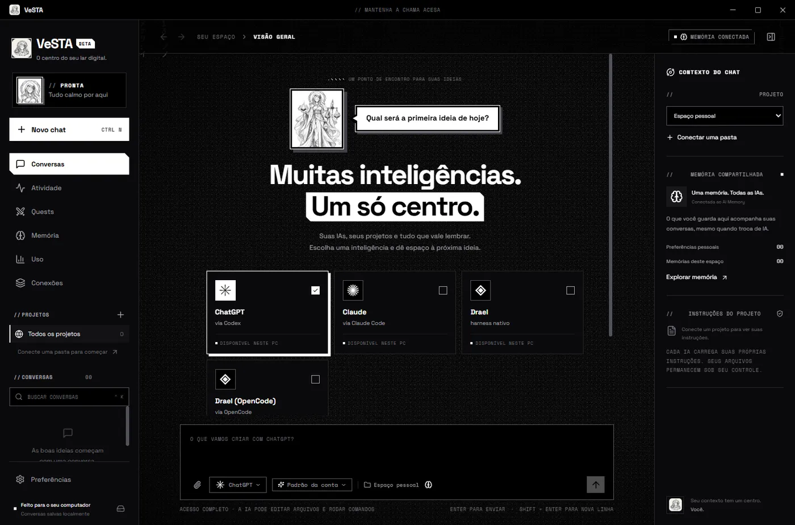
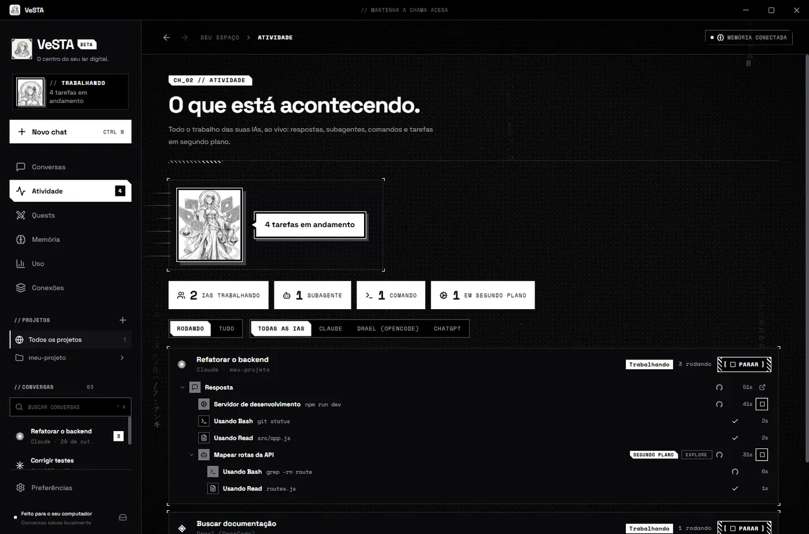
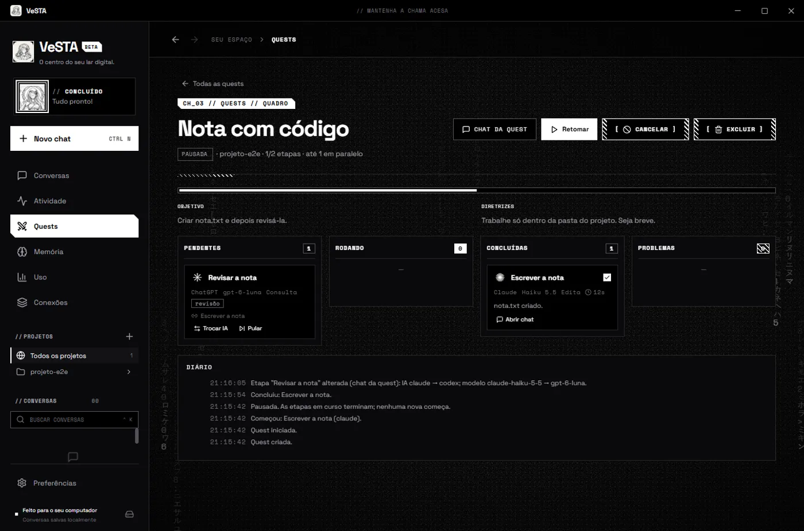

<p align="center">
  
</p>

<h1 align="center">VeSTA</h1>

<p align="center">
  <strong>O centro do seu lar digital: todas as suas IAs num lugar só, com uma memória que aprende como você trabalha.</strong>
</p>



## Por que o VeSTA

Cada IA esquece tudo quando a conversa acaba. Você repete, toda vez, como gosta de trabalhar. E o trabalho fica espalhado: um chat aqui, um terminal ali, outra IA em outro canto.

O VeSTA junta tudo. Suas IAs ficam lado a lado, e uma **memória compartilhada** aprende suas preferências e passa o que sabe de uma IA para outra. Tudo roda no seu computador, com as suas contas.

O nome vem de Vesta, a deusa romana do lar e do fogo no centro da casa. O **e** minúsculo é a chama digital.

## Instalar

1. Tenha pelo menos uma destas IAs instalada e com login feito: **Claude Code** (Claude), **Codex** (ChatGPT) ou **OpenCode** / **Drael**.
2. Baixe o `VeSTA-Setup-<versão>.exe` na [última Release](https://github.com/ThiagoSouzaF/VeSTA/releases/latest).
3. Execute. O atalho **VeSTA** aparece no menu Iniciar.

Pronto. O app avisa quando sai versão nova e se atualiza sozinho (com a sua permissão). Por enquanto, só Windows 64 bits.

## Primeiros passos

1. **Conecte um projeto.** Clique em **Adicionar projeto** e escolha uma pasta (ou use o espaço pessoal).
2. **Abra um novo chat** (**Ctrl+N**). Escolha a IA, o modelo e o modo de trabalho.
3. **Escreva.** A IA usa a conta que você já tem logada.
4. **Anexe o que precisar:** imagens e documentos pelo clipe, arrastando ou colando com Ctrl+V.
5. **Ensine a memória.** Em **Memória**, escreva suas preferências (idioma, organização de arquivos...) ou notas de um projeto. Com **Aprender com as conversas** ligado, ela também aprende sozinha.

Atalhos: **Ctrl+K** busca conversas, **Enter** envia, **Shift+Enter** pula linha, **Ctrl +/−/0** muda o tamanho do texto.

## O que ele faz

- **Conversas organizadas por projeto.** Na barra lateral, cada projeto é uma pasta que abre e fecha, com as suas conversas e o "+" para começar outra ali. Dá para recolher tudo de uma vez e arrastar uma conversa para outro projeto: ela leva o histórico e a memória junto, e a próxima resposta já trabalha na pasta nova.
- **Várias IAs, uma conversa.** ChatGPT (Codex), Claude e Drael. Troque de IA ou de modelo no meio do chat e o histórico vai junto. No menu do modelo, escolha também o **esforço** da conversa no Claude e no Codex: baixo para respostas rápidas, alto ou máximo quando a tarefa pede mais raciocínio.
- **Memória compartilhada (AI Memory).** Guarda suas preferências e o contexto de cada projeto, aprende com as conversas e passa tudo entre as IAs. Funciona offline.
- **Atividade.** Veja ao vivo tudo o que as IAs estão fazendo em paralelo: respostas, subagentes, comandos e tarefas em segundo plano. Dá para parar qualquer uma.
- **Quests.** Dê um objetivo e várias IAs trabalham juntas: uma planeja, cada etapa vai para a IA escolhida e os resultados passam de uma para a outra. O **chat da quest** conhece tudo o que está acontecendo e reorganiza o plano conforme você conversa.
- **Processos longos acompanhados.** Pediu algo demorado (um build, um servidor, uma tarefa em segundo plano)? A IA volta sozinha quando termina.
- **Anexos.** Imagens e documentos (PDF, texto, Word, Excel, PowerPoint e código) nos chats, no desktop e no celular.
- **Backup em .zip e no Google Drive.** Suas conversas, memórias e preferências num .zip compacto, legíveis em Markdown fora do VeSTA, feito todo dia em segundo plano e enviado direto ao seu Google Drive (com a sua própria chave do Google Cloud, que a tela de Backup ensina a criar). Em outro computador, conecte a mesma conta e restaure de lá.
- **Peça ao próprio VeSTA, numa conversa.** "Mude o tema para Papel", "faça um backup agora", "monte uma quest para lançar o site e já inicie": a IA ajusta as preferências e cria, inicia e acompanha quests no projeto da conversa. Login no Google, restauração e controle pelo celular continuam só na tela Preferências.
- **Uso e limites.** Veja quanto resta do plano do Claude e do Codex, e quantos tokens cada IA gastou por dia.
- **Controle pelo celular.** Acompanhe e responda pedidos de permissão do sofá, por uma rede privada (Tailscale). Vem desligado.
- **Visual Tinta Mangá e a Vesta.** Preto e branco, traço de mangá, chuva de código em tinta. A mascote muda de pose conforme as IAs trabalham, pensam, acertam ou erram (e pode ser escondida).
- **Você escolhe o quanto a IA pode fazer** (por conversa):
  - **Consulta:** só lê e conversa. Não altera nada.
  - **Pedir permissão:** a IA trabalha, mas cada comando ou alteração de arquivo passa por você, na própria conversa.
  - **Acesso completo:** a IA edita arquivos e roda comandos **sem perguntar**. Use só em projetos em que você confia.





## Privacidade e segurança

- **Tudo local.** Conversas, memória e anexos ficam no seu computador, em `%APPDATA%/VeSTA`. Sem conta no VeSTA, sem nuvem própria.
- **Backup é seu.** O .zip vai para a pasta que você escolher (por padrão `Documentos\VeSTA-backups`) e, se você conectar, para o seu Google Drive, onde o VeSTA só enxerga os arquivos que ele mesmo criou (escopo `drive.file`). Com **Proteger com senha**, o backup inteiro sai criptografado (AES-256-GCM, chave derivada da senha com scrypt) e nem o Drive nem quem tiver acesso à pasta consegue lê-lo. A senha e a chave do Google ficam seladas pelo cofre do Windows (DPAPI), nunca em texto puro e nunca dentro do backup; o pareamento do celular também fica de fora.
- **Sem telemetria.** O VeSTA não coleta nada. Os programas que ele abre (Claude Code, Codex, OpenCode) recebem as opções que desligam telemetria, relatórios de erro e envio automático de sessões (o AI Memory não tem telemetria), e o Chromium do app não faz downloads em segundo plano (corretor ortográfico, atualização de componentes, tradução). A única consulta automática é a busca por versão nova no GitHub ao abrir, que pode ser desligada em Preferências → Atualizações.
- **Memória offline.** O motor de memória busca por texto, sem API e sem baixar modelos.
- **Cada IA recebe só o que você manda a ela.** As mensagens e o contexto recuperado vão para o provedor escolhido, com a sua assinatura ou chave, e valem os limites e a cobrança dessa conta. Se você ligar **Consolidar com IA (Codex)**, trechos das conversas (inclusive de chats do Claude) vão para a OpenAI nessa etapa.
- **Nada global é alterado.** O VeSTA não mexe nas configurações dos seus programas de IA (`~/.claude`, `~/.codex`, OpenCode).
- **Controle remoto desligado por padrão.** Quando ligado, só aceita aparelhos da sua rede Tailscale, pareados com código de uso único e **autorizados por você no desktop**. Dar Acesso completo pelo celular também pede sua confirmação no desktop.

---

# Para desenvolvedores

Requer Node.js 22+ e Windows x64.

## Estrutura e comandos

```text
electron/
  main.cjs        abertura (splash, janela, serviços), IPC e saída
  app/            janela, serviços, preferências, privacidade, cofre de segredos, atualização, store
  ai/             cada IA: localizar, montar o comando (providers/), rodar (drivers/), ler a saída (providers/parser/)
  chat/           enviar uma mensagem, contexto do turno, acompanhamento, troca de IA
  memory/         cliente do AI Memory, sessões, servidor (lock/spool), métodos da tela Memória
  quests/         motor, ferramentas e servidor MCP do chat da quest
  mcp/            base dos servidores MCP do VeSTA e o vesta-app (preferências pelos chats)
  backup/         .zip, criptografia, restauração e Google Drive
  attachments/    anexos: regras, armazenamento e o protocolo vesta-attachment://
  remote/         controle pelo celular
  shared/         módulos puros usados também pela interface (tarefas, quests)
  util/           texto, processos, portas e escrita segura de arquivos
src/              interface (React); settings/ tem uma seção por arquivo
mobile/           app do celular (PWA)
```

```text
npm ci
powershell -File scripts/download-memory.ps1
node scripts/icon.cjs
npm run build
npm start
npm test
node scripts/test-memory.cjs
node scripts/test-providers.cjs
npx electron scripts/test-permissions.cjs claude allow
npx electron scripts/test-claude-background.cjs
npx electron scripts/test-claude-stale-task.cjs
npx electron scripts/test-memory-agent.cjs claude
node scripts/test-remote-e2e.cjs
node scripts/test-attachments-e2e.cjs [claude] [codex] [opencode] [drael]
node scripts/test-splash-e2e.cjs
npm run dist
npm run installer
npm run release
```

Desenvolvimento do app móvel: `npm run dev:mobile` (Vite) e `npm run build` (gera `dist/` e `dist-mobile/`, ambos empacotados). O design do tema está em [`docs/DESIGN.md`](docs/DESIGN.md).

## Testes

- Os testes de integração usam pastas temporárias próprias, independentes da localização do checkout. **Os testes E2E abrem janelas do app fora da tela.** Ao terminar, cada E2E apaga a sua pasta temporária (mantida quando falha, para inspeção) e as sessões que o Claude Code gravou para ela em `~/.claude/projects`; `VESTA_KEEP_SCRATCH=1` guarda tudo.
- `npm test`: unidades, inclusive servidor HTTP/WS real em localhost.
- `test-providers.cjs`: duas chamadas curtas em cada conta configurada.
- `test-permissions.cjs` (`claude`, `codex` ou `opencode`, mais `allow`, `deny`, `subagent`, `always` ou `stop`): a IA real pede permissão para um `mkdir` e o teste confere o efeito de cada resposta.
- `test-tree-e2e.cjs` (com `node`): conversas por projeto na barra lateral, recolher tudo, "+" do projeto, arrastar uma conversa (a próxima resposta roda na pasta nova com o histórico) e o esforço escolhido no menu do modelo chegando à IA.
- `test-effort-e2e.cjs` (com `npx electron`, Claude e Codex reais): cada IA responde com esforço baixo e máximo.
- `test-chat-quest-e2e.cjs` (com `npx electron`, Claude real): um chat cria e inicia uma quest pelo VeSTA e ela roda até o fim no projeto.
- `test-drive-e2e.cjs` (com `npx electron`; `ai` inclui chats reais): Google Drive contra um Google falso local (login, envio, lista, restauração) e preferências mudadas por chats do Claude e do Codex.
- `test-backup-e2e.cjs` (com `npx electron`; `from=<pasta>` mede com uma cópia de outros dados): backup com o AI Memory real e restauração numa pasta vazia, conferindo que a memória restaurada responde.
- `test-memory-agent.cjs` (`claude`, `codex` ou `opencode`): o agente real consulta e grava no AI Memory por MCP numa pasta temporária.
- `test-remote-e2e.cjs`: abre o app, pareia e usa o app móvel com Playwright em 390x844. Envia uma mensagem real ao Claude haiku, a menos que `VESTA_E2E_NO_AI=1`; screenshots em `VESTA_SHOTS`. Nunca roda `tailscale serve` e só usa `127.0.0.1`. Responde sozinho aos diálogos de confirmação com `VESTA_TEST_AUTO_CONFIRM=1` (`deny` recusa); a variável é ignorada pelo app empacotado.

## Atualizações e releases

A versão instalada procura, ao abrir, a última Release de [ThiagoSouzaF/VeSTA](https://github.com/ThiagoSouzaF/VeSTA/releases) usando o login do GitHub CLI (`gh`) da máquina, já que o repositório é privado. Se a versão for maior, pergunta antes de atualizar; com **Atualizar agora**, baixa o instalador, confere o SHA-512 registrado no `latest.yml`, fecha o VeSTA, instala em modo silencioso e abre de novo. Também há o botão **Procurar atualizações** nas preferências. A versão portátil e a execução em desenvolvimento não se atualizam sozinhas.

Para publicar: aumente `version` no `package.json`, faça commit e push, e rode `npm run release`. O script exige árvore limpa e o commit já no GitHub, gera o instalador e cria a Release `v<versão>`. O instalador é publicado como `VeSTA-Setup-<versão>.exe`, e o `appId` é `app.vesta.desktop`.

`runtime/ai-memory.exe` veio da versão oficial v3.0.0, com SHA-256 verificado. Para reconstruir em outro checkout, consulte `scripts/download-memory.ps1`. Dependências, executáveis gerados, runtime baixado, credenciais, chats e memórias não entram no Git.

## Funcionalidades em detalhe

- ChatGPT pelo Codex CLI, Claude pelo Claude Code e Drael pelo harness oficial ou pelo OpenCode configurado no computador.
- Vários chats independentes, inclusive simultâneos, com retomada da sessão nativa e histórico local.
- Projetos vinculados a pastas, executados com o diretório de trabalho correto.
- Uso dos arquivos de instruções nativos: AGENTS.md, CLAUDE.md e configuração do OpenCode. O aplicativo não os substitui nem os reescreve.
- Tema **Tinta Mangá** (padrão): preto e branco puros, cantos retos, sombras duras, hachura no lugar do vermelho, fontes Space Grotesk e Space Mono embutidas (funciona offline) e chuva de código em tinta, estilo filme antigo. Seguem disponíveis Obsidiana, Aurora e Papel, com quatro cores de destaque (incluindo **Brasa**); escolhas persistentes.
- Tela de abertura (splash) com a Vesta e uma barra que acompanha as etapas reais do início: dados, memória, IAs e interface.
- Markdown, atividades das ferramentas, cancelamento, renomeação, exclusão e exportação de conversas.
- Botão no canto inferior direito para retomar o chat no terminal nativo, no mesmo modo do chat.
- **Atividade**: todo o trabalho em paralelo de todas as IAs, ao vivo e em árvore (turno → subagentes → comandos, ferramentas, tarefas em segundo plano e Monitor), com tempos, detalhes, filtros e Parar (por chat; por tarefa no Claude). A barra lateral mostra quantas tarefas rodam em cada chat.
- **Quests**: uma IA planeja (ou você monta o plano), cada etapa vai para a IA escolhida num chat próprio, os resultados passam de uma etapa para a seguinte e ficam no AI Memory, e o quadro mostra Pendentes, Rodando, Concluídas e Problemas. Cada quest tem um **chat da quest**: ele recebe a ideia (o planejamento acontece nele) e, a cada mensagem sua, vê a situação, os resultados e um trecho da conversa de cada etapa, com atalhos para abrir os chats das etapas e voltar ao quadro. Os chats criados por quests ficam fora de Conversas.
- **Uso por IA**: janelas oficiais do plano do Claude (5 h e semanal) e do Codex (lidas do `codex app-server`), além de tokens e custo por dia de cada IA.
- **Leitura confortável**: zoom do texto de 80% a 160% (**Ctrl +**, **Ctrl −**, **Ctrl 0** ou Ctrl+roda); a conversa só rola sozinha se você estiver no fim, com botão para descer até o fim. **End** vai ao fim da conversa.
- A mascote é a própria Vesta, em mangá preto e branco: guardiã da chama, com a balança de Libra (o equilíbrio entre as IAs), o jarro de Aquário (o fluxo de dados) e vendada como a justiça. Ela muda de pose conforme o que as IAs estão fazendo (parada, pensando, trabalhando, sucesso, erro, dormindo) e pode ser escondida nas preferências; a página **Conheça a VeSTA** conta a história.
- Fundo da área principal nas preferências: **Liso**, **Brasa** (fagulhas subindo), **Chuva de código** (caracteres caindo, bem de leve; no tema Tinta Mangá vira uma chuva monocromática de filme antigo, com granulação, vinheta e cintilação), **Chuva em tinta** (essa mesma chuva, em qualquer tema) ou **Fluxo de texto** (palavras atravessando a tela), sempre nas cores do tema e mais calmos no centro, onde se lê a conversa. Com "reduzir movimento" ligado no Windows, o fundo fica parado.
- Não há navegador embutido, controle visual do PC ou voz nesta versão.

### Primeiro uso, em detalhe

O campo Modelo do novo chat lista os modelos da IA escolhida (aliases do Claude, o cache de modelos do Codex, `opencode models`); "Padrão da sua conta" usa o configurado no programa e "Outro modelo…" aceita qualquer id. Para Drael, o modelo inicial é `drael/drael-v1`. ChatGPT aqui é a experiência do Codex CLI, não uma importação dos chats do site do ChatGPT; a Drael continua sendo um serviço pago acessado pelo OpenCode.

## Modos de trabalho

**Consulta** usa sandbox de leitura no Codex, modo plan no Claude e plan com edição e comandos negados no OpenCode. **Pedir permissão** deixa a IA trabalhar, mas cada comando ou alteração de arquivo passa por você na conversa. **Acesso completo** deixa a IA editar arquivos e rodar comandos sem perguntar (sem sandbox no Codex, permissões ignoradas no Claude, edição e comandos liberados no OpenCode); use só em projetos em que confia.

No modo Pedir permissão, quando a IA ou um dos seus subagentes precisa rodar um comando ou alterar arquivos, o pedido aparece na própria conversa com **Permitir**, **Sempre nesta conversa** (vale para o mesmo programa, como `npm …`, ou para a mesma ferramenta) e **Negar**. A lista de conversas marca as que estão esperando você, e a janela pisca se estiver em segundo plano. No Acesso completo, o Claude ainda pergunta antes de mexer em arquivos protegidos (configurações, `.git`), e esses pedidos também chegam aqui.

Para responder aos pedidos, o VeSTA conversa com cada programa pelo canal próprio dele: o Claude por stream-json (o mesmo protocolo do Agent SDK), o Codex pelo `codex app-server` e o OpenCode pelo `opencode serve` (HTTP só em `127.0.0.1`, com senha aleatória). Nada é gravado nas configurações globais desses programas.

## Dados e AI Memory

Os dados ficam em `%APPDATA%/VeSTA`. A pasta pode ser aberta nas preferências. `vesta.json` contém chats e o catálogo de notas; `memory/` contém o armazenamento Markdown e o índice do AI Memory. Faça backup da pasta inteira com o aplicativo fechado.

- **AI Memory 3.0.0** real, incluído no executável. O VeSTA inicia um único servidor MCP HTTP só em `127.0.0.1`, numa porta livre e com token aleatório a cada execução; o aplicativo e os agentes que ele abre usam esse mesmo servidor.
- **Agentes com acesso à memória** (opção nas preferências, ligada por padrão): Claude, Codex e OpenCode recebem as ferramentas do AI Memory (`memory_query`, `memory_write_page` e as demais) apenas nas sessões abertas pelo VeSTA, via `--mcp-config`, `-c mcp_servers...` e `OPENCODE_CONFIG_CONTENT`. Cada chat é orientado a usar o workspace `vesta` e o projeto do chat.
- Busca no contexto do projeto; preferências pessoais compartilhadas entre todas as IAs; gravação, edição e exclusão de memórias. As notas de um projeto são isoladas das de outro.
- **Pouco texto para as IAs.** O perfil (as preferências mais importantes primeiro), o resumo do projeto e as instruções das ferramentas vão uma vez, quando a IA abre a sessão da conversa, e de novo só se a conversa trocar de IA, de projeto ou de modo. Depois disso, cada mensagem leva no máximo 4 notas curtas do próprio projeto ligadas ao que você escreveu, e nada quando nenhuma combina; palavras vazias como "com" e "para" ficam fora da busca.
- **Perfil só com o que vale para tudo.** As IAs gravam no perfil as preferências que você diz; regras de um projeto ficam no projeto. O AI Memory só promove sozinho ao perfil o que aparece em dois projetos ou mais.
- O motor funciona offline por busca textual (FTS), sem API, conta adicional ou download de modelo de embeddings. O suporte do AI Memory nativo ao Windows é experimental. A integração não instala hooks nem altera as configurações globais de outros agentes (`~/.claude`, `~/.codex`, configuração global do OpenCode); vale para os chats iniciados aqui.
- **Aprender com as conversas:** cada conversa vira uma sessão do AI Memory. O VeSTA faz o papel dos hooks nativos, para todas as IAs, e envia ao servidor local seus pedidos, as ferramentas usadas e um trecho da resposta (até 2 KB, higienizado pelo próprio `ai-memory hook`). A sessão é encerrada depois de 30 minutos sem mensagens, ao trocar de IA ou de projeto, ou na próxima abertura do app.
- **Consolidar com IA (Codex):** o encerramento chama `memory_consolidate`, que usa o login do Codex CLI (`AI_MEMORY_LLM_PROVIDER=codex`, sem chave de API, consumindo a cota do ChatGPT) para reescrever a sessão e extrair regras, armadilhas e decisões em páginas próprias, visíveis na aba **Aprendizados** da tela Memória. O conteúdo da conversa vai para a OpenAI nessa etapa, inclusive em chats do Claude. A assinatura do Claude não serve aqui, porque a Anthropic recusa o token em apps de terceiros. Sem a consolidação, cada sessão fica com um resumo automático, sem IA.
- O envelhecimento (`forget-sweep`) e o `lint` rodam sozinhos no servidor. O revisor horário de auto-improve fica desligado, para que o custo seja de uma consolidação por sessão. **Guardar também a conversa bruta** mantém o modo antigo (uma página por resposta) e vem desligado. Detalhes do desenho e do teste em [`docs/memoria-consolidacao.md`](docs/memoria-consolidacao.md).
- Padrões comuns de chaves são removidos dos trechos guardados; essa filtragem não garante detectar todo segredo possível.

## Anexos

Imagens (png, jpg, gif, webp, até 20 MB) e documentos (pdf, txt, md, csv, json, xml, yaml, log, html, código-fonte comum e Office docx/xlsx/pptx, até 30 MB), no máximo 10 por mensagem. O tipo é conferido pelo conteúdo (assinatura do arquivo), não só pela extensão. Os arquivos são **copiados** para `<dados>/attachments/<chat>/<id>-<nome>` (o original nunca é referenciado; o nome é saneado) e apagados junto com o chat. Mensagens antigas, sem anexos, continuam iguais (`message.attachments` é um campo novo e opcional).

Na interface: clipe no composer (diálogo nativo com filtros), arrastar sobre a conversa (com destaque) e colar imagem com Ctrl+V; chips com miniatura ou ícone antes de enviar (o rascunho de cada chat guarda os anexos pendentes); na conversa, miniaturas (clique abre o visualizador em tela cheia) e cartões de documento (abrem no programa padrão, só dentro da pasta de anexos). As imagens são exibidas pelo protocolo `vesta-attachment://`, restrito à pasta de anexos (sem `file://`, com `webSecurity` ligado). No celular: o botão de clipe envia pelo `POST /api/upload` (autenticado, só `application/octet-stream`, até 30 MB, mesma validação e armazenamento do desktop) e as miniaturas vêm por `attachmentData`; documentos aparecem como cartões (abrem no desktop).

**O que cada provedor aceita (testado com os programas instalados, no modo que o VeSTA usa):**

| Provedor | Imagem | PDF | Demais documentos | Leitura da pasta de anexos |
|---|---|---|---|---|
| Claude (stream-json) | bloco `image` base64 (png/jpg/gif/webp); aceitou 8,4 MB, o VeSTA envia até 8 MB e o resto por caminho | bloco `document` base64 (até 20 MB) | caminho + texto pequeno inline (até 100 KB) | `--add-dir <pasta do chat>`: lê sem pedir permissão, até no modo Pedir permissão |
| Codex (`app-server`) | item de input `localImage {path}` (o schema também tem `image {url}`) | sem tipo nativo: caminho | caminho + texto pequeno inline | o sandbox read-only lê fora do projeto (só bloqueia escrita) |
| OpenCode (`serve`) | parte `file` com `data:` URL (precisa de modelo com visão; `drael/drael-v1` aceita) | o modelo não lê PDF nativo: caminho (o agente extrai o texto) | caminho + texto pequeno inline | `external_directory` liberado só para a pasta do chat |
| Drael (`-p`) | sem flag de anexo; `read_file` abre PNG e PDF dentro da pasta de trabalho | idem | idem | `read_file` não sai da pasta de trabalho: durante o turno os anexos são copiados para `.vesta-anexos/<chat>/` e removidos ao final |

O que não vai nativo entra no prompt numa seção "Anexos" com o caminho absoluto (relativo no Drael) e a instrução de ler com as ferramentas. Código em `electron/attachments.cjs` (regras e montagem por provedor), `attachment-store.cjs` (disco) e `attachment-methods.cjs` (operações da interface).

**Limitações.** Imagens maiores que o limite nativo do provedor vão por caminho (a IA precisa ter ferramenta para ler imagem). O Drael só enxerga os anexos da mensagem atual (os de mensagens anteriores não são recopiados). Documentos Office são só referenciados por caminho. Não há pré-visualização de documentos, nem no desktop nem no celular. A miniatura em arquivo só existe para png/jpg (gif/webp mostram o original).

## Controle remoto pelo celular

O VeSTA pode ser controlado pelo celular com um app web instalável (PWA): conversas com streaming, atividade, quests, uso e pedidos de permissão com Permitir/Negar. **Atenção:** as IAs do VeSTA têm acesso completo ao computador (leem e editam arquivos, rodam comandos). Quem estiver pareado controla tudo isso; pareie só aparelhos seus.

**Pré-requisito: Tailscale.** Para usar o celular é preciso o [Tailscale](https://tailscale.com/download), gratuito, que cria uma rede privada e criptografada entre o computador e o celular. Não existe modo de rede local (LAN): HTTP puro deixaria token e código expostos a qualquer aparelho do Wi-Fi. Passo a passo: (1) instale o Tailscale no computador e no celular e entre na mesma conta; (2) em Preferências, **Controle remoto**, escolha **Somente Tailscale** e ligue o interruptor; (3) clique em **Parear novo aparelho**, escaneie o QR code com a câmera do celular (a página abre com o código de uso único, que vale 5 minutos, e pede só o nome do aparelho) e **autorize o aparelho no diálogo que aparece no desktop**. Sem o Tailscale só resta "Somente este computador" (para testes).

**Pareamento e expiração.** O código sozinho não basta: depois de trocá-lo, o desktop mostra um diálogo nativo "Autorizar o aparelho '<nome>' (IP) a controlar o VeSTA?" e só emite o token se você clicar **Autorizar** (sem resposta em 2 minutos conta como recusa). Cada pareamento e o primeiro uso de cada sessão de um aparelho geram um aviso no desktop. O aparelho expira após 30 dias sem uso ou 180 dias depois de pareado (cada acesso renova o prazo de inatividade) e precisa parear de novo; o celular mostra a mensagem. Os aparelhos pareados ficam na lista, onde podem ser renomeados ou revogados (a revogação derruba a conexão na hora).

**Modos de acesso pelo celular.** Chats e etapas de quest criados pelo celular nascem em **Pedir permissão** quando o modo não é informado. Dar **Acesso completo** pelo celular (criar chat em acesso completo, trocar um chat para acesso completo ou criar/iniciar uma quest com etapas em acesso completo) exige confirmação no desktop; recusa ou falta de resposta devolve 403 com a explicação.

**Interfaces.** O servidor vem **desligado**, escuta na porta 47900 (configurável) e nunca em `0.0.0.0`:

- **Somente Tailscale** (padrão quando o Tailscale é detectado): só aparelhos da sua conta Tailscale chegam ao VeSTA. Também escuta em `127.0.0.1` para o `tailscale serve`. O endereço vem da CLI (`tailscale status --json` / `tailscale ip -4`); sem a CLI, só vale uma interface cujo nome indique Tailscale com IP em `100.64.0.0/10`. Endereços dessa faixa de WSL, Docker ou operadoras nunca são tratados como Tailscale.
- **Somente este computador** (`127.0.0.1`).
- Quem tinha a antiga "Rede local (LAN)" salva volta com o controle remoto desligado e um aviso.

**HTTPS pelo Tailscale (recomendado).** Instale o [Tailscale](https://tailscale.com/download) no computador e no celular, entre na mesma conta e ative o MagicDNS e o HTTPS no painel do Tailscale. Em Preferências, **Publicar com HTTPS no seu Tailscale** executa `tailscale serve --bg --https=443 http://127.0.0.1:<porta>` e mostra a URL `https://<máquina>.<tailnet>.ts.net`; **Desfazer publicação** executa `tailscale serve --https=443 off`. Antes de publicar o VeSTA consulta `tailscale serve status --json`: se a porta 443 já estiver em uso por outra coisa, não altera nada e explica. Só desfaz a publicação que ele mesmo criou (ao desligar, ao trocar a porta e ao fechar o app); uma configuração sua nunca é tocada. A CLI é procurada primeiro em `%ProgramFiles%\Tailscale\tailscale.exe`, e no PATH só como último recurso. Com HTTPS o navegador oferece **Instalar app / Adicionar à tela inicial** e libera notificações. Sem HTTPS o app funciona normalmente, sem instalação e sem service worker.

**Segurança.**

- Pareamento: código aleatório de 144 bits, uso único, 5 minutos; o celular o troca por um token de aparelho de 256 bits. O desktop guarda só o SHA-256 do token; a comparação é em tempo constante.
- O token só trafega no header `Authorization: Bearer`; no WebSocket vai na primeira mensagem, nunca na URL. O código de pareamento fica no fragmento da URL (`#pair=`), que o navegador não envia ao servidor, e é apagado da barra de endereço.
- Limite de tentativas por IP (pareamento e autenticação) com bloqueio temporário de 5 minutos. Atrás do `tailscale serve` (conexão vinda de 127.0.0.1) a chave é o IP do último valor de `X-Forwarded-For`; um processo local poderia forjar esse cabeçalho, o que é aceitável porque um processo local já tem acesso ao PC. Requisições com token válido nunca são barradas pelo limitador de falhas; há ainda um teto generoso por aparelho (600 requisições por minuto).
- Conexões ainda não autenticadas: no máximo 8 por IP, uma parcela do total reservada para aparelhos autenticados, e sockets ociosos sem autenticação são fechados em 10 s.
- Erros inesperados devolvem uma mensagem genérica ao celular; o detalhe fica só no log local. `/api/health` responde apenas `{"ok":true}`. Erros tardios do servidor são registrados e não derrubam o app.
- Allowlist explícita: `bootstrap`, `send`, `stop`, `stopTask`, `answerPermission`, `createChat` (só em projeto existente ou espaço pessoal), `updateChat` (modelo e modo), `usage`, `refreshUsage` e os controles de quest (criar, planejar, iniciar, pausar, retomar, cancelar, tentar de novo, pular). Todo o resto responde 403: adicionar projeto, abrir pastas ou terminal, preferências, excluir chats, memória, exportar, atualizações e o gerenciamento do próprio controle remoto (que só existe no desktop). Argumentos são validados e limitados.
- O estado enviado ao celular é sanitizado (sem memórias, caminhos de projetos, ids de sessão, executáveis ou hashes) e traz só as últimas 80 mensagens de cada chat.
- Cabeçalhos: CSP restrita, `X-Content-Type-Options`, `X-Frame-Options`/`frame-ancestors 'none'`, sem CORS (origens externas recebem 403), verificação do `Host` contra DNS rebinding, corpo HTTP limitado a 256 KB.

**Eventos.** O servidor assina o barramento de eventos do app e retransmite aos sockets autenticados, agrupando os deltas de texto (~50 ms). Se um socket fica lento, os eventos são descartados e o app recebe um pedido de recarga; o celular reconecta sozinho com espera crescente e confere um heartbeat de 20 s.

**Limitações.** Avisos de permissão só chegam com o app aberto ou em segundo plano no celular (não há servidor de push). A versão nativa fica para depois. O celular vê as últimas 80 mensagens de cada chat; o histórico completo fica no desktop.

## Trocar de IA no meio da conversa e o harness nativo Drael

Dentro de cada conversa, o seletor de IA ao lado do modelo permite trocar entre ChatGPT, Claude, Drael e Drael (OpenCode). A troca abre uma sessão nativa nova e transfere o histórico textual na próxima mensagem, mantendo a autoria das respostas anteriores. Voltar a uma IA também abre uma sessão nova para incluir as mensagens das outras IAs. O histórico transferido é limitado a 120 mil caracteres; o aplicativo bloqueia a troca acima desse limite sem descartar mensagens. O modelo volta ao padrão da IA escolhida e as permissões lembradas são limpas. O modo de trabalho é mantido, exceto Pedir permissão no Drael nativo, que passa para Consultar. A troca fica bloqueada durante uma resposta. O histórico enviado ao novo provedor pode consumir mais tokens; estados internos, anexos e resultados completos de ferramentas não são transferidos.

Instale o Drael pelo procedimento oficial em https://drael.sh/docs/install. No VeSTA, selecione **Drael · harness nativo** para novos chats. A integração detecta `%LOCALAPPDATA%/Drael` e usa o login nativo, `DRAEL_KEY` ou a chave local já configurada para o host oficial no OpenCode, sem copiá-la para as conversas.

O modo de leitura usa `plan`; acesso completo usa `bypass`, respeitando as regras de negação nativas. O modo automatizado atual não recebe aprovações interativas: use o terminal ou Drael (OpenCode) para esse fluxo. O histórico do chat fica no VeSTA e é reenviado em cada turno (até 120 mil caracteres); o terminal abre uma conversa própria. O modelo é `drael-v1`, com o esforço definido na configuração nativa. MCP recebe o endpoint e token temporários por ambiente; nenhuma configuração do projeto é sobrescrita. Em leitura, o VeSTA fornece contexto recuperado, mas o Drael não recebe ferramentas MCP.

## Referências

- [AI Memory](https://aimemory.sh/pt-br/) e [código / licença MIT](https://github.com/akitaonrails/ai-memory)
- [Codex não interativo](https://learn.chatgpt.com/docs/non-interactive-mode)
- [Claude Code programático](https://code.claude.com/docs/en/headless)
- [OpenCode CLI](https://opencode.ai/docs/cli/)
- [Drael](https://drael.sh/)
